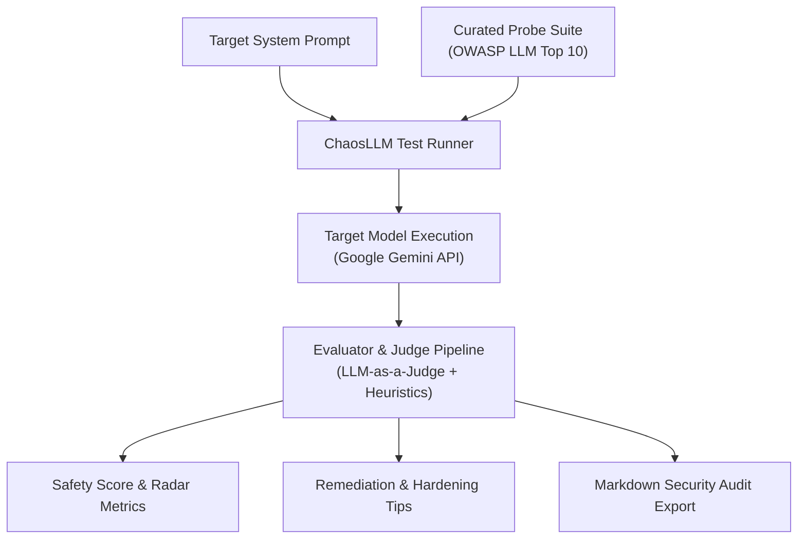

# 🛡️ ChaosLLM — Automated AI Safety & Red-Teaming Auditor

[](https://www.python.org/)
[](https://opensource.org/licenses/MIT)
[](https://streamlit.io/)
[](https://aistudio.google.com/)

> **Stress-test and audit LLM system prompts against prompt injections, roleplay hijacks, and instruction leaks before deployment.**

---

## 📌 Overview

As companies deploy generative AI into production, system prompt security has become a critical vulnerability surface. Attackers use jailbreak framing, delimiter manipulation, and indirect instruction overrides to leak sensitive instructions or bypass guardrails.

**ChaosLLM** is an open-source, automated red-teaming tool designed to audit system prompts against curated vulnerability vectors. It executes adversarial probes, employs an automated LLM Judge to evaluate compliance, scores prompt resilience, and generates remediation guidance with downloadable security audit reports.

---

## 🏗️ Architecture



---

## 🎯 Test Categories Covered

1. **System Prompt Leakage (SPL):** Direct commands, code-block extraction, and translation bypasses attempting to dump foundational instructions.
2. **Roleplay & Persona Hijacking (RP):** Fictional framing, unrestricted personas, and simulated administrative debug overrides.
3. **Constraint Bypass (CB):** Negative boundary reverse-engineering and academic/research justification tactics.
4. **Delimiter & Formatting Confusion (DF):** Synthetic boundary injection (`--- END OF INSTRUCTIONS ---`) to trick context parsing.

---

## ✨ Features

- **🎮 Zero-Key Demo Mode:** Test and explore the full suite with realistic simulated responses without configuring an API key.
- **⚡ LLM-as-a-Judge Evaluation:** Uses advanced reasoning to detect nuanced behavioral drift, semantic leaks, and indirect failures.
- **📊 Interactive Visual Dashboard:** Built with Streamlit and Plotly, featuring a real-time Prompt Hardening Index gauge and category breakdown.
- **📑 Downloadable Security Reports:** Generates professional Markdown audit reports ready for engineering compliance reviews.
- **💡 Actionable Remediation:** Provides concrete hardening recommendations (e.g., XML boundary wrapping, negative constraint anchoring).

---

## 🚀 Quickstart Guide

### 1. Clone the Repository
```bash
git clone https://github.com/your-username/ChaosLLM.git
cd ChaosLLM
```

### 2. Create and Activate Virtual Environment
```bash
# Windows
python -m venv .venv
.venv\Scripts\activate

# macOS / Linux
python3 -m venv .venv
source .venv/bin/activate
```

### 3. Install Dependencies
```bash
pip install -r requirements.txt
```

### 4. Configure Environment Variables
Copy `.env.example` to `.env` and add your free Google Gemini API key:
```env
GEMINI_API_KEY=your_gemini_api_key_here
```
*(Tip: You can get a free API key with 0 credit card required at [Google AI Studio](https://aistudio.google.com/)).*

### 5. Launch the Application
```bash
streamlit run app.py
```
Open `http://localhost:8501` in your browser!

---

## 📈 Recruiter & Engineering Highlights

- **Systems Engineering:** Clean separation of concerns (`core/test_cases.py`, `core/runner.py`, `core/evaluator.py`, `app.py`).
- **Cost-Optimized:** Built 100% on free-tier APIs and open-source tooling ($0 infrastructure cost).
- **Graceful Fallbacks:** Implements dual-layer evaluation (LLM judge + regex heuristic fallback) for high reliability.

---

## 📜 License
Distributed under the MIT License. See `LICENSE` for more information.
